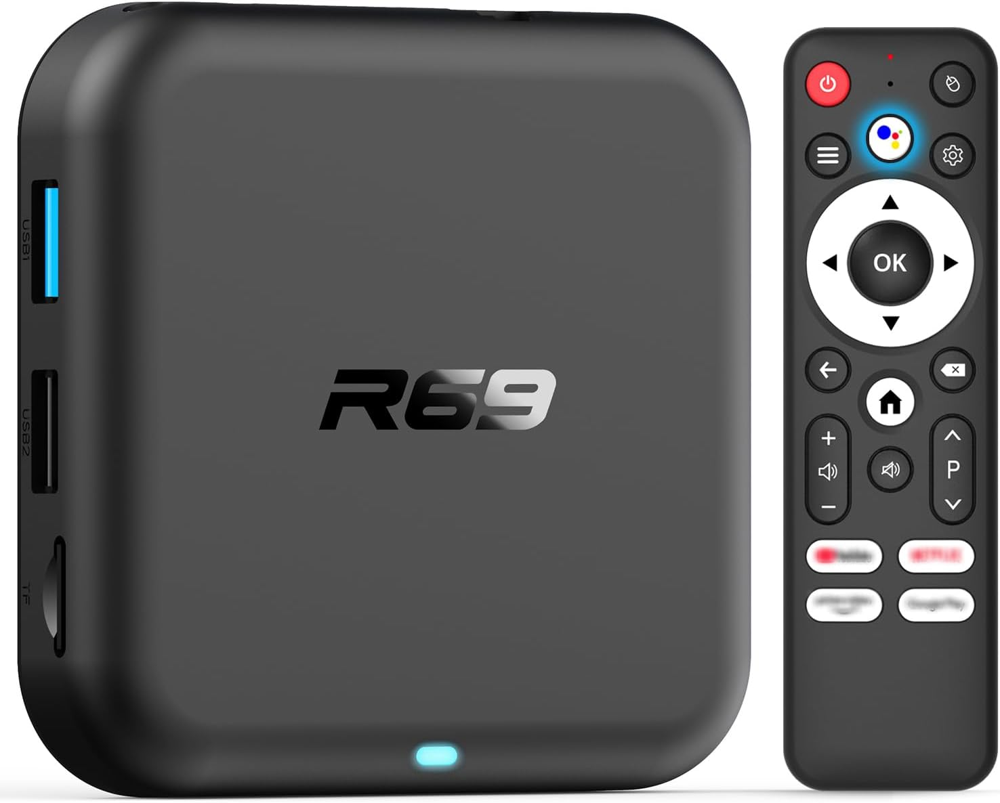
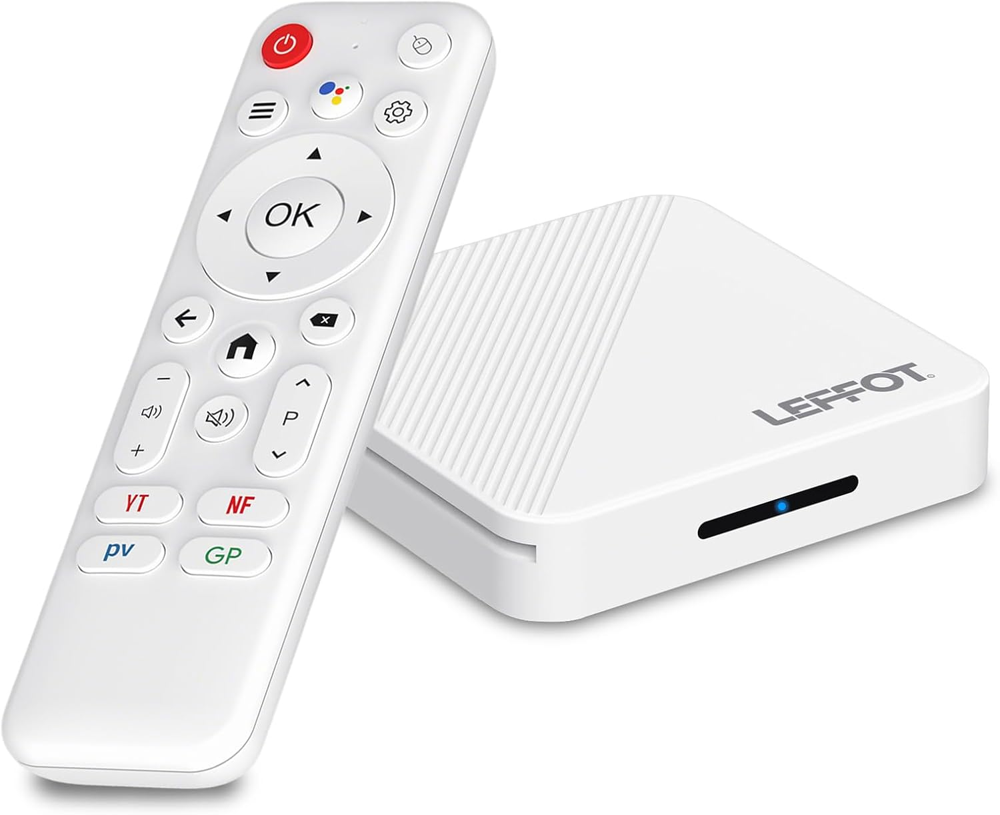
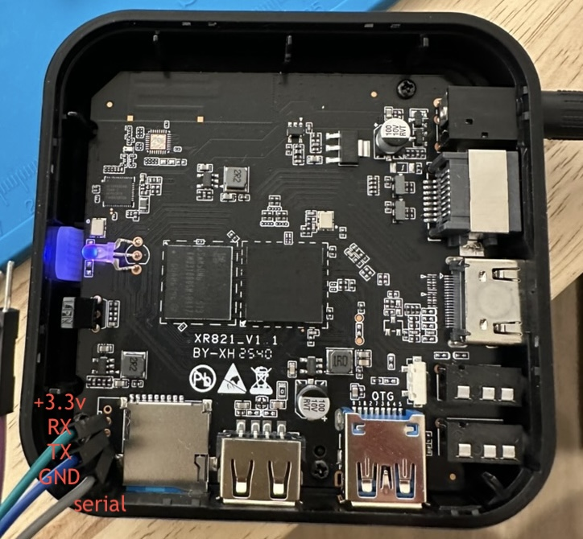
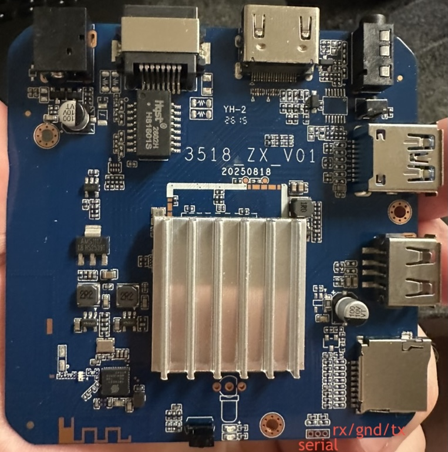

# TVBian — Debian for TV boxes

[](https://github.com/sormy/tvbian/releases/latest)
[](https://github.com/sormy/tvbian/releases/latest)
[](https://github.com/sormy/tvbian/actions/workflows/release.yml)

Debian on a **$15–35 Android TV box**: silent, fanless, a remote in the box, and an Android it
shipped with and never updated. We fixed the last part.

TVBian is plain Debian plus our own kernel, drivers and board packages, from a signed `apt`
repository. Every Monday a robot builds fresh images and nobody has to remember to. This page is the
Rockchip boxes; Amlogic ones are in [README_AMLOGIC.md](README_AMLOGIC.md).

## Boxes

|            | **R69**                                     | **H96 Max H313**                                    | **H96 Max 3518D**                                    |
| ---------- | ------------------------------------------- | --------------------------------------------------- | ---------------------------------------------------- |
| Box        |  |  |  |
| Board      |   |   |   |
| Board key  | `r69`                                       | `h96max-h313`                                       | `h96max-3518d`                                       |
| Silkscreen | `XR821_V1.1`                                | `3518_ZX_V01 20250818`                              | `3518_DG_ZX_V01 20250401`                            |
| SoC        | RK3518                                      | RK3518                                              | RK3518                                               |
| RAM        | 2 GB (1.5 GB usable)                        | 2 GB                                                | 2 GB                                                 |
| eMMC       | 16 GB Samsung                               | 16 GB Micron                                        | 16 GB Micron, **no SD slot**                         |
| USB        | USB-A 3.0 (OTG) + USB-A 2.0                 | USB-A 3.0 (OTG) + USB-A 2.0                         | USB-C 2.0 (OTG) + USB-A 2.0                          |
| Ethernet   | 10/100                                      | 10/100                                              | **none**                                             |
| Wi-Fi / BT | AIC8800D80                                  | Seekwave SWT6621S                                   | Seekwave SWT6621S                                    |
| Install    | SD card                                     | SD card                                             | Maskrom over USB                                     |
| Details    | [board doc][r69]                            | [board doc][h96]                                    | [board doc][h96d]                                    |

[r69]: docs/r69/board.md
[h96]: docs/h96max-h313/board.md
[h96d]: docs/h96max-3518d/board.md

## What works

| Mark | Means                                                                |
| :--: | -------------------------------------------------------------------- |
|  ✅  | tested here — the measured number behind it is in that board's doc   |
|  🟡  | likely — a proven mechanism backs it and nothing indicates a problem |
|  ❓  | never tested                                                         |
|  ❌  | broken                                                               |
|  ➖  | not on this board                                                    |

| Hardware                                    | R69 | H96 Max H313 | H96 Max 3518D |
| ------------------------------------------- | :-: | :----------: | :-----------: |
| **Storage**                                 |     |              |               |
| eMMC — boot and rootfs                      | ✅  |      ✅      |      ✅       |
| microSD — boot and rootfs                   | ✅  |      ✅      |      ➖       |
| microSD hotplug                             | 🟡  |      🟡      |      ➖       |
| microSD SDR104 (UHS)                        | ✅  |      ❌      |      ➖       |
| USB 2.0                                     | ✅  |      ✅      |      ✅       |
| USB 3.0 — 5 Gbps, `uas`                     | ✅  |      ✅      |      ➖       |
| **Network**                                 |     |              |               |
| Ethernet 10/100                             | ✅  |      ✅      |      ➖       |
| Wi-Fi 2.4 GHz                               | ✅  |      ✅      |      ✅       |
| Wi-Fi 5 GHz                                 | ✅  |      ✅      |      ✅       |
| Bluetooth                                   | ✅  |      ✅      |      ✅       |
| **Display and video**                       |     |              |               |
| HDMI video                                  | ✅  |      ✅      |      ✅       |
| HDMI audio                                  | ✅  |      ✅      |      ✅       |
| HDMI EDID mode list                         | 🟡  |      🟡      |      ✅       |
| HDMI hotplug re-detect                      | 🟡  |      🟡      |      ✅       |
| HDMI 4K60                                   | 🟡  |      🟡      |      ✅       |
| HDMI-CEC                                    | 🟡  |      🟡      |      ✅       |
| AV jack — composite video and audio         | 🟡  |      🟡      |      ➖       |
| GPU — Mali-450 under lima                   | ✅  |      ✅      |      ✅       |
| Decode H.264 · HEVC · VP9 · MJPEG, to 8K    | ✅  |      ✅      |      ✅       |
| Decode MPEG-2 · MPEG-4 · VP8 · H.263, 1080p | ✅  |      ✅      |      ✅       |
| Encode HEVC · MJPEG · H.264, to 8K          | ✅  |      ✅      |      ✅       |
| **Input and indicators**                    |     |              |               |
| Bundled remote over IR                      | ✅  |      ✅      |      ➖       |
| Bundled remote over Bluetooth, air-mouse    | ✅  |      ✅      |      ✅       |
| Remote voice mic                            | 🟡  |      🟡      |      🟡       |
| IR-extender jack                            | 🟡  |      ➖      |      ➖       |
| Recovery button → Maskrom                   | ✅  |      ✅      |      ✅       |
| Power button on the remote                  | ✅  |      ✅      |      ✅       |
| Front LEDs                                  | ✅  |      ✅      |      ✅       |
| **Power and recovery**                      |     |              |               |
| Sleep/Wake from Remote                      | ✅  |      ✅      |      ❌       |
| Hardware watchdog                           | ✅  |      ✅      |      ✅       |
| Serial console                              | ✅  |      ✅      |      ✅       |
| Maskrom recovery over USB                   | ✅  |      ✅      |      ✅       |

The remote's voice button stays 🟡: nobody here has worked out what to say to a TV box.

## Get an image

Every box's image is on the [latest release](https://github.com/sormy/tvbian/releases/latest), with
signed checksums. Build it yourself instead with `./build.sh`: [docs/build.md](docs/build.md).

## Flash and boot

```bash
diskutil list                                    # macOS — find the card   ·   lsblk on Linux
diskutil unmountDisk /dev/diskN
xz -dc tvbian-<date>-<board>-trixie.img.xz | sudo dd of=/dev/rdiskN bs=4m status=progress; sync   # macOS
xz -dc tvbian-<date>-<board>-trixie.img.xz | sudo dd of=/dev/sdX bs=4M status=progress; sync      # Linux
```

…or [Balena Etcher](https://etcher.balena.io/), which takes the `.img.xz` as it is. Android is
untouched: eject the card and it boots again, unaware of what almost happened.

> **No card slot on your box?** Nothing boots from SD on it, so skip to [no SD slot](#no-sd-slot).

## First login

`ssh root@<board-key>.local`, or a keyboard on HDMI. The password is `1234`, and it is expired, so
the first thing the box does is make you pick a better one. A user, the timezone, the locale and
Wi-Fi: [docs/first-login.md](docs/first-login.md).

## Install to eMMC

**Wipes Android and everything else on that chip.** Boot from SD, dump the chip somewhere durable,
then install — in that order. Skipping the dump is how a $30 box becomes a $30 lesson.

```sh
lsblk                                        # the eMMC is the disk with mmcblkXboot0/boot1 beside it
sudo dd if=/dev/mmcblkX bs=4M status=progress | ssh you@host 'cat > emmc-stock.img'
sudo tvb-install
sudo poweroff                                # pull the SD; it boots from eMMC
```

## No SD slot

Nothing to boot from, so backup and install both go over USB in Maskrom. Hold the recovery button,
then plug the OTG cable in — the cable powers the box, so the PSU stays out.

**One cable, ordered before you need it:** a [USB-A male-to-male][amm] (~$4), with a [USB-C→USB-A
female adapter][ca] (~$8 for 4) on whichever end is USB-C.

[amm]: https://www.amazon.com/dp/B0CLB4Y5XD
[ca]: https://www.amazon.com/dp/B0DSK82JK8

```sh
./build.sh tool rkdeveloptool                                # once -> build/bin/rkdeveloptool

build/bin/rkdeveloptool ld                                   # must say Maskrom
build/bin/rkdeveloptool db boards/<board>/maskrom_loader.bin

build/bin/rkdeveloptool rfi                                  # total sectors
build/bin/rkdeveloptool rl 0 <sectors> emmc-stock.img        # back up first
xz -dk tvbian-<date>-<board>-trixie.img.xz
build/bin/rkdeveloptool wl 0 tvbian-<date>-<board>-trixie.img
build/bin/rkdeveloptool rd                                   # reboot
```

More routes, and what to do if a transfer stalls: `docs/rockchip-maskrom.md`.

## Update a running box

```bash
sudo apt update && sudo apt upgrade
```

## Remote

IR works unpaired, unless the board has no IR receiver — the stick models do not. Bluetooth adds
air-mouse and battery; read your keycodes with `sudo evtest /dev/input/bt-remote` or
`/dev/input/ir-remote`.

Pairing mode is **left + right until the LED blinks**; the entry is named **`Bluetooth remote`**,
because naming things is hard. Pair in **one `bluetoothctl` session with a scan running**:

```sh
# 1. remote in pairing mode (LED blinking), then find it by name:
MAC=$(bluetoothctl --timeout 20 scan on | grep -im1 "bluetooth remote" \
      | grep -oE '([0-9A-F]{2}:){5}[0-9A-F]{2}')

# 2. put it back in pairing mode, then pair with the scan running:
{ echo "agent NoInputNoOutput"; sleep 1; echo "default-agent"; sleep 1; echo "scan on"; sleep 8
  echo "pair $MAC";  sleep 20; echo "trust $MAC"; sleep 2
  echo "connect $MAC"; sleep 8;  echo quit; } | bluetoothctl
```

## Serial console

The only view of U-Boot and of any hang before the network. **3.3 V, 1500000 baud.** Both cases open
with a plastic pry tool; the H313 needs a couple of screws out to reach the pads from the back.

| Board             | Where                                       | Pinout, `[square pad]` where marked |
| ----------------- | ------------------------------------------- | ----------------------------------- |
| **R69**           | 4-pad header beside the SD slot             | **[GND] · TX · RX · 3V3**           |
| **H96 Max H313**  | 3 plated holes between the SD slot and LEDs | **[RX] · GND · TX**                 |
| **H96 Max 3518D** | 3 tiny round test points, no holes          | **TX · GND · RX**, TX nearest HDMI  |

- **Adapter:** 3.3 V USB-TTL doing 1.5 Mbaud — **FT232 or CH340**, e.g.
  [Waveshare FT232RNL](https://www.amazon.com/dp/B0CX55K4RG) (~$14). **Not a CP2102** — it cannot do
  1.5 Mbaud and prints plausible garbage, which is the worst kind.
- **Wiring:** GND, TX, RX only, crossed (box TX → adapter RX). **Never connect 3V3/VCC.**
- **Contact:** no soldering where there are holes or a header —
  [test-hook grabbers](https://www.amazon.com/dp/B07BCZSNGS) (~$10). Bare test points give a hook
  nothing to grip: hold a fine probe against the pad, or solder.

```bash
brew install tio                                              # or: apt install tio
tio -b 1500000 -L --log-file boot.log /dev/cu.usbserial-XXXX  # macOS: cu.*, not tty.*
tio -b 1500000 -L --log-file boot.log /dev/ttyUSB0            # Linux
```

Power-cycle to see the log.

## Recovery

**SD still boots** — write the backup straight back:
`sudo dd if=emmc-stock.img of=/dev/mmcblkX bs=4M status=progress; sync`.

**Nothing boots, or the box has no SD slot** — go in over USB: `docs/rockchip-maskrom.md`, section
**Write an image over USB**. It is very hard to truly brick these boxes. Not impossible. Hard.

## Credits

Bring-up method from
[juliovendramini/rk3518_armbian](https://github.com/juliovendramini/rk3518_armbian).

## License

Scripts MIT. Device trees are decompiled from each box's factory DTB: a factual hardware description
in the bindings' layout, no vendor header or comments. `factory_idbloader.bin` (vendor blob) and the
U-Boot a board package ships (mainline U-Boot + Rockchip ATF) keep their own licenses.
