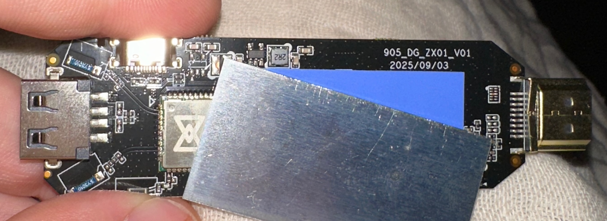

# H96 Max M20

Board id `h96max-m20`, provisional — the box's own strings say `S905LTS` on platform `p291`.
Measured on one unit; these numbers are per-unit and they decay. The full factory evidence sweep is
`stock/h96max-m20/README.md`.

**In bring-up.** Boots from a USB stick unattended and runs TVBian from it, migrated in place from
Armbian: Debian trixie, kernel `6.18.57-tvb-meson64`, `tvb-h96max-m20`, NetworkManager. eMMC, USB,
Ethernet (via a USB adapter), the power LED, HDMI, the GPU, and H.264, HEVC and VP9 decode and
encode work. Nothing is installed to eMMC. Known gaps are at the bottom.

## Identity

| Property    | Value                                                               |
| ----------- | ------------------------------------------------------------------- |
| SoC         | Amlogic S905L3 — GXLX2, `p291` reference board, RevE                |
| CPU         | 4× Cortex-A53, 1200 MHz                                             |
| RAM         | 2 GB LPDDR3, rank0+1 @ 600 MHz                                      |
| eMMC        | SanDisk `DF4016`, 30777344 sectors = 15.76 GB                       |
| Wi-Fi / BT  | MediaTek MT7668 on SDIO, func1 Wi-Fi and func2 Bluetooth            |
| Ethernet    | ➖ no connector fitted; the tree disables the SoC MAC block         |
| USB         | 2.0 only; USB-C is OTG, USB-A host-only                             |
| Front panel | one blue LED on `GPIODV_24`, active low; one button; no IR receiver |
| Serial      | 115200 on three pads centre-back: HDMI <- TX GND [RX]               |
| AV, S/PDIF  | ➖ not fitted: HDMI is the only video and audio out                 |
| PCB marking | `905_DG_ZX01_V01`, date code `2025/09/03`                           |



## Addresses

| Interface | Address             | Where it comes from                             |
| --------- | ------------------- | ----------------------------------------------- |
| unifykey  | `62:b4:4d:3b:72:e6` | the `mac` slot, the factory's `eth0`; unused    |
| wlan0     | `d0:aa:5f:32:eb:f2` | the chip's own eFUSE, read through the firmware |
| bdaddr    | `D0:AA:5F:32:EB:F3` | the chip's own, one above its eFUSE             |

`mac_wifi` and `mac_bt` read `exist=none`, so there is no fused value to recover for those two.

## Measured on Armbian

Kernel 6.18.44, image of 2026-09-17. `fio --direct=1`, `iperf3` to a wired host.

| Measure                        | Value                                            |
| ------------------------------ | ------------------------------------------------ |
| Boot to `graphical.target`     | 14.1-16.7 s over 10 boots, mt76 at boot ✅       |
| TVBian: reboot to SSH          | 34-38 s over 3 boots, 2026-10-20 ✅              |
| RAM                            | 1954 MB ✅                                       |
| eMMC sequential read           | 43.3 MiB/s ✅                                    |
| eMMC sequential write          | 32.7 MiB/s ✅                                    |
| eMMC random 4K read            | 2711 IOPS, 10.6 MiB/s ✅                         |
| eMMC random 4K write           | 3839 IOPS, 15.0 MiB/s ✅                         |
| USB drive (rootfs) read        | 21.3 MiB/s ✅                                    |
| USB drive (rootfs) write       | 21.1 MiB/s ✅                                    |
| USB drive random 4K read       | 1842 IOPS ✅                                     |
| USB drive random 4K write      | 1644 IOPS ✅                                     |
| USB throughput (via Gb NIC)    | 196 Mbit/s, idle and under 4-core load ✅        |
| `stress-ng` 4×cpu + 2×vm       | 120 s `--verify`, 6 passed, 0 failed ✅          |
| Watchdog                       | systemd 80 s, hardware 65.5 s ✅                 |
| CPU, idle                      | 67 °C                                            |
| CPU, 5 min `stress-ng --cpu 4` | 88 °C peak; 1.0-1.2 GHz from 50 s                |
| HDMI                           | 2256x1504 @ 60.00 Hz, the panel's native mode ✅ |
| GPU, `kmscube`                 | 60.0 fps vsync-locked, Mali-450 at 744 MHz ✅    |
| GPU, `glmark2-es2-drm`         | **64** at 2256x1504 on screen, no artifacts ✅   |

The eMMC write figures were taken in the last 128 MiB, outside the factory partitions, and the
region was saved and restored byte-identical afterwards.

The USB drive is USB 3, on this USB 2.0 host at `480M` through a hub, bound to `usb-storage`.

The watchdog counts at 1 kHz into 16 bits, so the hardware stops at 65.5 s; systemd asks for the
same 80 s as the Rockchip boards and the kernel pings the hardware in between.

**The Ethernet number is a USB measurement.** No Ethernet is fitted, so it is a USB-attached RTL8153
on a USB 2.0 host that is also serving the rootfs — 196 Mbit/s is the bus, not the NIC.

**The box cannot hold full speed.** Under four-core load the 80 °C passive trip holds it at 1.0-1.2
GHz within a minute; bursts reach 1.752 GHz. Amlogic's tree throttled from 85 °C.

### Kernel log

Every warning and error a running box logs, known here, at loglevel `warn` and above:

| Line                                          | Cause                                 |
| --------------------------------------------- | ------------------------------------- |
| `arch_timer`, `kvm`, `GIC` IRQ lines          | the factory's timer and GIC nodes     |
| `KASLR`, `cacheinfo`, `arm_pmu` affinity      | nothing for them in the tree          |
| `supply … not found`, `no regulator (mali)`   | fixed rails the tree leaves out       |
| `can't get clk-gate pinctrl`, three hosts     | an optional MMC pin state             |
| `unaligned sg offset`                         | one mt76 transfer, sent without DMA   |
| `meson-dw-hdmi` fails to bind                 | built-in GXL driver; `-gxlx2` binds   |
| `loading out-of-tree module taints kernel`    | the `tvb-meson-venc` encoders         |
| `Skipping dt linux,cma-default for "cma="`    | a `cma=` on the command line          |
| `Read Local Supported Commands not supported` | `btmtksdio-mt7668` `0001`             |
| `Missing L0 reference POC`                    | HEVC entered mid-stream, after a seek |
| `invalid device node of gpio INTC`            | a GPIO request on the AO bank         |

❌ `stop_streaming operation is leaving buffer N in active state`, a `WARN` with a trace, is a
decoder bug, not a tolerated line.

## Video codecs

The decoder, `meson-vdec`, is patched into TVBian's kernel; the encoders, `amvenc_avc` and
`amvenc_hevc`, build out of tree from `modules/meson-venc.conf`. GStreamer's `v4l2*dec` and
`v4l2*enc` drive them.

| Codec     | Decode 720p     | 1080p           | 4K              | Encode 720p | 1080p | 4K  |
| --------- | --------------- | --------------- | --------------- | ----------- | ----- | --- |
| H.264     | ✅              | ✅              | ✅              | ✅          | ✅    | ➖  |
| HEVC      | ✅              | ✅              | ✅              | ✅          | ✅    | ✅  |
| VP9       | ✅              | ✅              | ✅              | ➖          | ➖    | ➖  |
| MPEG-1/2  | ✅              | ✅              | ➖              | ➖          | ➖    | ➖  |
| MPEG-4    | ✅              | ✅              | ➖              | ➖          | ➖    | ➖  |
| VC-1      | ✅              | ✅              | ➖              | ➖          | ➖    | ➖  |
| MJPEG     | ✅              | ✅              | not implemented | ➖          | ➖    | ➖  |
| AVS, AVS2 | not implemented | not implemented | not implemented | ➖          | ➖    | ➖  |
| RealVideo | not implemented | not implemented | ➖              | ➖          | ➖    | ➖  |

Decode ✅ is bit-exact against ffmpeg's software decode over every frame, the rest within IDCT
rounding: MPEG-1/2 66-68 dB, MPEG-4 59-66 dB, MJPEG 73 dB; encode ✅ is the PSNR below. ➖ is beyond
the hardware: the H.264 encoder stops at 1920x1088.

MJPEG decodes to I420 only: its microcode writes three planes. VC-1 is the Advanced profile; a
skipped frame yields no new picture, and the last two pictures of a stream stay in the microcode.
GStreamer configures a V4L2 VC-1 decoder from 1.26.6; trixie ships 1.26.2, and
`patches/gst-plugins-good/README.md` rebuilds its plugin with the fix.

ffmpeg's `*_v4l2m2m` reach every codec the driver decodes, and both encoders, with five patches to
9.0.2 in `research/ffmpeg-v4l2m2m/`: pts for raw streams, `extradata` for MPEG-1/2, MPEG-4 and VC-1,
an `mjpeg_v4l2m2m` decoder, encoder `extradata` for Matroska and MP4, and a drain that waits for a
CAPTURE buffer. Another, `0009`, makes its decoders ask for a scaled CAPTURE: `-capture_max_height`;
`0010` and `0011` carry a decode across a resolution change. Debian's 7.1.5 decodes H.264, HEVC, VP9
and MPEG-2 from a container; MPEG-4, VC-1, raw streams and encode to Matroska fail.

**On screen, 4K plays at 30 fps and glitches at 60.** The display's video plane cannot read whole
3840x2160 NV12 pictures 60 times a second, about 750 MB/s; 1080p60 and 4K30 play clean. A client can
ask for a half-size CAPTURE per stream, `meson-codecs` `0017`, and 4K HEVC at 60 fps then decodes at
74 fps against 58. HEVC takes coded sizes up to 4096x2304, `0018`: DCI 4K and 4K coded at 2176
lines.

**Not implemented:** the silicon decodes AVS, AVS2 and RealVideo — the factory loads `amvdec_avs`,
`amvdec_avs2`, `amvdec_real` — but no V4L2 driver for them exists on this chip.

| Measure, 60 frames of `testsrc2` | Value                                       |
| -------------------------------- | ------------------------------------------- |
| Decode, 4K                       | H.264 2.57 s, HEVC 2.94 s, VP9 2.64 s       |
| H.264 encode, 8 Mbit/s           | 720p 51.5 dB, 1080p 45.7 dB                 |
| HEVC encode, 8 Mbit/s            | 720p 51.1, 1080p 44.9, 4K 38.7 dB in 11.6 s |
| Peak CMA, 4K decode              | VP9 254 MiB, HEVC 139, H.264 124            |

## eMMC over the OTG port

`amlcmd` drives the burning gadget; `src/amlcmd/README.md` is the procedure.

| Measure          | Value                                 |
| ---------------- | ------------------------------------- |
| read             | 12.4 MiB/s, 256 MiB in 20.6 s ✅      |
| write            | 9.3 MiB/s, 256 MiB in 27.4 s ✅       |
| full backup      | 15758000128 bytes in about 25 min ✅  |
| 256 MiB verified | written back and re-read identical ✅ |

The rate is set by the gadget, not the host: one control round trip per 64 KiB slot and an endpoint
re-arm every 4 KiB from U-Boot's polling loop. A C client and a Python one measured within 2% of
each other on the same range.

Sectors 73760–74271 are the key window inside `reserved`; a whole-device pass needs
`store disprotect key` in front of it or it stops there.

## Building an image

```bash
brew install xz coreutils mtools u-boot-tools   # macOS  ·  apt install xz-utils mtools u-boot-tools
./build-e2tools.sh                              # once — stock e2tools corrupts an image on delete
./build-image.sh Armbian_..._Lepotato_..._minimal.img.xz h96max-m20
```

The base is Armbian Le Potato, and the build refuses any other image. Output is two partitions: a
512 MiB FAT32 holding `aml_autoscript`, `u-boot.ext` and `boot.scr`, then the Armbian rootfs. The
eMMC is untouched — Android still boots with the stick out.

## Booting it

Write the image to a USB stick and plug it into the USB-A port. The **first** boot needs the
environment pointed at the stick once: over the OTG cable with `amlcmd`, the recipe in
`README_AMLOGIC.md`, or at the serial prompt. A cold boot runs `try_auto_burn`, whose USB gadget
makes `usb start` hang, so over serial warm-reboot first:

```
reboot normal
usb start 0
run recovery_from_udisk
```

On the first stick boot `aml_autoscript` rewrites the factory environment — clearing `try_auto_burn`
and pointing `bootcmd` at the stick, with `run storeboot` as the fallback — so **every later
power-on boots the stick with no serial at all**. Pull the stick and the box boots Android as
before; the button's burning-mode path is untouched.

| Step             | What runs                                       |
| ---------------- | ----------------------------------------------- |
| `aml_autoscript` | chain-loads our U-Boot, `u-boot.ext`, with `go` |
| `boot.scr`       | hands over to the rootfs's `extlinux.conf`      |

The chain-load exists because U-Boot 2015 computes a modern arm64 kernel's load address as 0 and
aborts on the memmove — `booti` fails whatever address the kernel is loaded at.

## Wireless

Mainline mt76 is the driver: `patches/mt76-mt7668/`, patched into TVBian's kernel and loaded at
boot, with `btmtksdio` beside it. MediaTek's own driver is the fallback and is not shipped;
`patches/mt76x8-mt7668/README.md` builds it. Only one may claim the part, so running the fallback
means blacklisting `mt7663s` in `/etc/modprobe.d/`.

Swapping drivers needs no reboot. Unload the running one while it still holds the card, then cycle
the sdio host so the next one finds a powered-down part. On the box:

    rmmod wlan_mt76x8_sdio        # or: rmmod mt7663s
    echo d0070000.sdio > /sys/bus/platform/drivers/meson-gx-mmc/unbind
    echo d0070000.sdio > /sys/bus/platform/drivers/meson-gx-mmc/bind
    modprobe mt7663s              # or: modprobe wlan_mt76x8_sdio

### Both drivers, measured 2026-09-25

`iperf3` against a wired host on the LAN, wlan0 given its own address and routing table so the
traffic cannot leave over Ethernet. Two 10 s runs per TCP direction, 30 s both ways, 20 idle pings.
Throughput in Mbit/s; the access point runs channel 40 at 80 MHz and channel 6 at 20 MHz.

| Driver | Domain | Band    | TCP up     | TCP down   | UDP up/down | Both ways | Idle ping |
| ------ | ------ | ------- | ---------- | ---------- | ----------- | --------- | --------- |
| mt76   | US     | 5 GHz   | 142, 151   | 142, 143   | 160 / 152   | 111 + 42  | 7.9 ms    |
| mt76   | none   | 5 GHz   | 141, 151   | 143, 144   | 160 / 150   | 110 + 44  | 9.0 ms    |
| vendor | US     | 5 GHz   | 150, 151   | 91, 150    | 163 / 162   | 114 + 40  | 8.7 ms    |
| vendor | none   | 5 GHz   | 148, 151   | 150, 151   | 162 / 162   | 103 + 52  | 8.9 ms    |
| mt76   | US     | 2.4 GHz | 91.9, 88.7 | 90.1, 89.9 | 102 / 92    | 43 + 52   | 15.1 ms   |
| mt76   | none   | 2.4 GHz | 92.4, 91.2 | 89.2, 89.9 | 101 / 93    | 50 + 45   | 9.1 ms    |
| vendor | US     | 2.4 GHz | 92.4, 93.5 | 86.5, 90.8 | 97 / 91     | 58 + 31   | 9.2 ms    |
| vendor | none   | 2.4 GHz | 91.5, 92.4 | 91.0, 90.4 | 100 / 94    | 75 + 18   | 11.3 ms   |

The mt76 rows predate the current build, whose 5 GHz download measures 150-151 over six runs of
three.

**The regulatory domain changes nothing measured here.** With none set, mt76 adopts `US` from the
access point's country element on joining, and the vendor registers self-managed wiphys with its own
domain; both associate on 5 GHz either way. `country 00` leaves 28 channels no-IR here against 3
under `US`.

A first download after a reload sometimes runs at about 90, under both drivers; the next is back to
full rate.

mt76 reconnects without a reload in 105-352 ms, 40 of 40. Joins from a reload complete in 3-4 s.

Under `stress-ng --cpu 4` mt76 held 2.4 GHz at 128 up and 113 down against 127 and 118 idle, 131 up
after the load (channel 1 at 40 MHz, -36 dBm, 2026-10-16). The vendor driver measured 88 up and 90
down on 2.4 GHz, 144 and 139 on 5 GHz (2026-09-20), and returned to baseline on the first
measurement after the load stopped.

**A `wpa_supplicant` conf may pin the channel.** One with `scan_freq` or `freq_list` scans only
those channels, and misses the access point once it moves: `skip - frequency not allowed`. A
configuration limit, not the part's.

`hci0` is `D0:AA:5F:32:EB:F3`, this unit's own, identical across three reboots.

mt76 reads `wlan0`'s address from the eFUSE through the firmware: the unit's own, one below the
Bluetooth one.

Under the vendor driver it depends on one key in `wifi.cfg`: at the factory's `EfuseBufferModeCal 1`
it is `00:0c:43:26:60:48`, the calibration blob's, the same on every board that installs the file;
at `EfuseBufferModeCal 0` it is the chip's own but the calibration is measurably weaker. Both bands
associate either way. Vendor driver, same access point and position, `iperf3` TX in Mbit/s
(2026-09-20):

| Calibration                  | `wlan0`             | 2.4 GHz        | 5 GHz    |
| ---------------------------- | ------------------- | -------------- | -------- |
| the blob                     | `00:0c:43:26:60:48` | 90, 92, 92     | 154      |
| the chip                     | `d0:aa:5f:32:eb:f2` | 57, 77, 77     | 126, 129 |
| the blob, MAC bytes replaced | `d0:aa:5f:32:eb:f2` | 89, 89, 94, 97 | 132-141  |

## Installing to eMMC

❓ Single boot, as CoreELEC installs: Android and `cache` go, the vendor bootloader stays and
chain-loads the image's own U-Boot. `build-image.sh` rewrites the factory MPT and both DTB copies in
`reserved` to this layout; `scripts/aml-emmc-install` writes it over the OTG cable.

| Sectors       | Holds                                           |
| ------------- | ----------------------------------------------- |
| 0–8191        | vendor bootloader — never written               |
| 8192–16383    | the image's U-Boot, read by `amlmmc` from `env` |
| 16384–73727   | FAT: `boot.scr`, `aml_autoscript`               |
| 73728–204799  | `reserved`: MPT, keys (never written), DTB × 2  |
| 237568–253951 | `env`: `bootcmd` loads the image's U-Boot       |
| 253952–end    | the ext4 rootfs                                 |

## Known gaps

| Item                 | State                                                                |
| -------------------- | -------------------------------------------------------------------- |
| Wi-Fi, mainline mt76 | ✅ both bands — its gaps in `patches/mt76-mt7668/README.md`          |
| Another access point | ✅ by a firmware reload, about 1 s more; same AP rejoins as fast     |
| Patch race           | ✅ either driver may patch first: `btmtksdio-mt7668` `0003`          |
| Wi-Fi, vendor driver | ✅ both bands, the fallback — numbers above                          |
| Bluetooth            | ✅ `btmtksdio-mt7668` in-tree: LE command bitmap, patch-race wait    |
| BLE remote           | ✅ pairs; keys as printed; 🟡 air-mouse, as on the 3518D             |
| cpufreq              | ✅ `scpi-cpufreq`, 100 MHz-1.752 GHz, the factory's table            |
| Thermal              | ✅ `cpu-thermal` on the SCPI sensor; passive 80 °C, hot 90 °C        |
| HDMI                 | ✅ `meson-dw-hdmi` in-tree: KMS; TV, PC monitor, hotplug             |
| GPU                  | ✅ lima, Mesa `Mali450`, devfreq 125-744 MHz                         |
| Kernel 7.2 (edge)    | ✅ boots; drivers, codecs, Wi-Fi, BT, HDMI and audio as on 6.18      |
| ffmpeg `v4l2m2m`     | ✅ all on patched 9.0.2; stock 7.1.5 ❌ MPEG-4, VC-1, MKV encode     |
| Other decoders       | not implemented: AVS, RealVideo                                      |
| HDMI audio           | ✅ 2-channel LPCM at 44.1, 48 and 96 kHz                             |
| CEC                  | ✅ `meson-ao-cec`: `/dev/cec0`, physical address from the EDID       |
| CEC messages         | ❓ this panel has no CEC to answer                                   |
| DDC/CI               | ✅ `ddcutil -b 0`: volume and brightness read, brightness set        |
| SD slot              | ➖ not fitted; the SD host registers with nothing behind it          |
| Reset button         | ➖ no Linux input: no free GPIO or ADC channel moves when pressed    |
| Suspend              | ❌ `s2idle` only, and no wake: keys ignore suspend and poweroff      |
| Standby LED          | ➖ not fitted: `GPIOZ_14`, the factory's `sys_green`, lights nothing |
| Install to eMMC      | ❓ the single-boot image verifies offline; never flashed             |
| `armbian-install`    | ✅ refuses before touching a disk: no `write_uboot_platform`         |
| Panic under a build  | ✅ three 4-job DKMS builds clean since the secmon fix                |
| Silent reset         | ✅ none since the secmon fix; once before it, during HEVC bring-up   |
| Network drop         | ❓ once, after a driver reload, minutes without ping; no reboot      |
| mt76 at boot         | ✅ loads and joins on its own, 18 of 18 warm reboots                 |
| Fresh image          | ❓ built with both DKMS sources staged; never booted                 |
| TVBian kernel        | ✅ 6.18.57: Wi-Fi, BT, HDMI, codecs, `soc0` `GXLX2 (S905L3)`         |
| TVBian image         | ❓ `./build.sh image h96max-m20` builds it; never booted             |
| Our U-Boot           | ✅ libretech-cc `v2026.10`, chain-loaded from the stick's FAT        |
| Poweroff             | ❓ on TVBian's kernel, without Armbian's `POWER_RESET_MESON64`       |
| First HEVC session   | ❌ aborts once in a while on `dec_status 0`; the next run decodes    |
| DRAM from the ROM    | ❌ writes fail; the mask ROM serves SRAM only                        |
| Unbrick via the ROM  | ❓ needs a USB-boot BL2; this board's ACS is format v3               |
